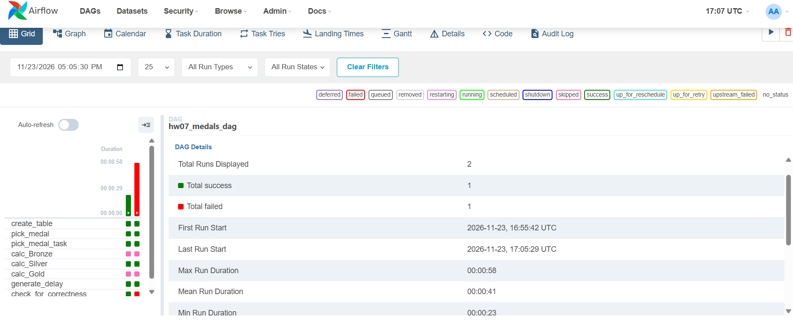
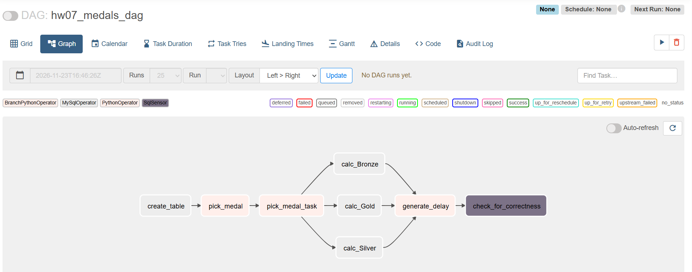
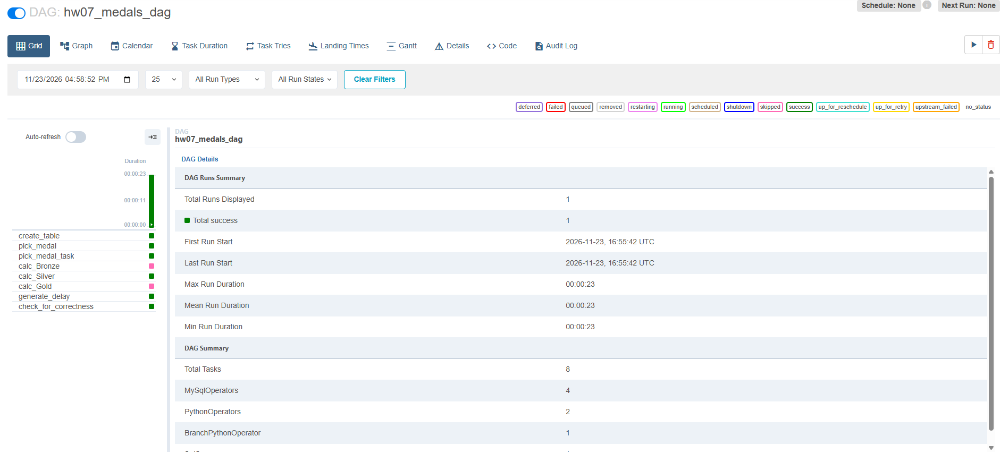
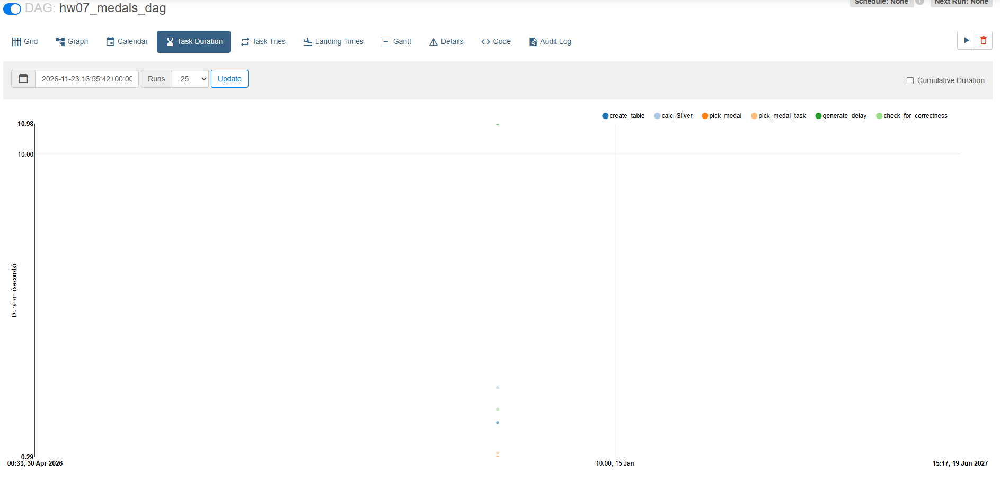
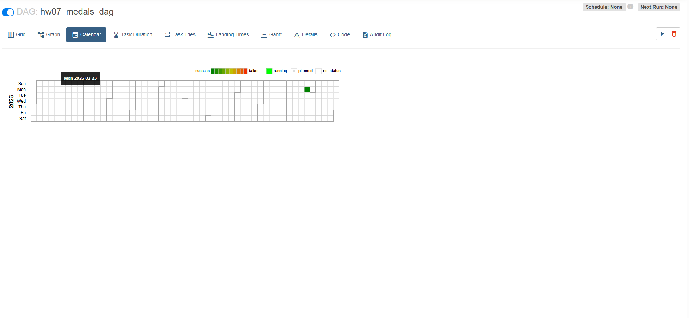

# goit-de-hw-07 — Apache Airflow

DAG `hw07_medals_dag`, який випадково обирає тип медалі, рахує кількість таких медалей у таблиці `olympic_dataset.athlete_event_results`, записує результат у MySQL та перевіряє сенсором, що запис справді з'явився.

> Через відсутність токена до `goitacademy/airflow_sandbox` (за погодженням із ментором) DAG запускався локально в Docker.

## Структура проєкту

```
goit-de-hw-07/
├── dags/
│   └── medals_dag.py      # DAG
├── screenshots/           # скриншоти виконання
├── docker-compose.yaml    # Airflow 2.5.0 (CeleryExecutor, Redis, PostgreSQL)
├── .env                   # підключення до MySQL (не комітиться)
└── .gitignore
```

## Завдання DAG

| # | Task | Оператор | Що робить |
|---|------|----------|-----------|
| 1 | `create_table` | MySqlOperator | `CREATE TABLE IF NOT EXISTS neo_data.hw07_medal_counts` з полями `id` (AUTO_INCREMENT, PRIMARY KEY), `medal_type`, `count`, `created_at` |
| 2 | `pick_medal` | PythonOperator | Випадково обирає одне зі значень `['Bronze', 'Silver', 'Gold']` і передає його через XCom |
| 3 | `pick_medal_task` | BranchPythonOperator | Залежно від обраного значення запускає `calc_Bronze`, `calc_Silver` або `calc_Gold`; інші дві гілки отримують статус `skipped` |
| 4 | `calc_Bronze` / `calc_Silver` / `calc_Gold` | MySqlOperator | Рахує записи з відповідним значенням у полі `medal` та вставляє в таблицю тип медалі, кількість і `NOW()` |
| 5 | `generate_delay` | PythonOperator | Затримка `time.sleep(DELAY_SECONDS)`; `trigger_rule=ONE_SUCCESS`, щоб задача виконувалась після однієї успішної гілки |
| 6 | `check_for_correctness` | SqlSensor | Перевіряє, що найновіший запис не старший за 30 секунд: `TIMESTAMPDIFF(SECOND, MAX(created_at), NOW()) <= 30` |

Залежності:

```
create_table >> pick_medal >> pick_medal_task >> [calc_Bronze, calc_Silver, calc_Gold] >> generate_delay >> check_for_correctness
```

## Запуск

1. Створити файл `.env` у корені проєкту:

   ```
   AIRFLOW_UID=50000
   NEO_DATA_ADMIN_CONN=mysql://<user>:<password>@<host>:3306/neo_data
   ```

   Змінна передається в Airflow як `AIRFLOW_CONN_NEO_DATA_ADMIN`, тому підключення `neo_data_admin` створюється автоматично.

2. Запустити Airflow:

   ```bash
   docker compose up airflow-init
   docker compose up -d
   ```

3. Відкрити http://localhost:8080 (логін / пароль: `airflow` / `airflow`), увімкнути DAG `hw07_medals_dag` і запустити його кнопкою **Trigger DAG**.

## Перевірка сенсора

- `DELAY_SECONDS = 10` — запис свіжий, `check_for_correctness` завершується успішно.
- `DELAY_SECONDS = 35` — запис старший за 30 секунд, сенсор падає за таймаутом.

## Результат

Було виконано два запуски (в обох випадково обрано `Silver`):

| Запуск | `DELAY_SECONDS` | Тривалість | Статус |
|--------|-----------------|------------|--------|
| 1 | 10 | 00:00:23 | ✅ success |
| 2 | 35 | 00:00:58 | ❌ failed — `check_for_correctness` впав, бо запис старший за 30 с |

Вміст таблиці `neo_data.hw07_medal_counts` після обох запусків:

| id | medal_type | count | created_at |
|----|------------|-------|------------|
| 1 | Silver | 42827 | 2026-11-23 16:55:50 |
| 2 | Silver | 42827 | 2026-11-23 17:05:41 |

### Grid: успішний запуск і запуск із затримкою 35 секунд


### Graph


### Grid (статуси задач)


### Task Duration


### Calendar

